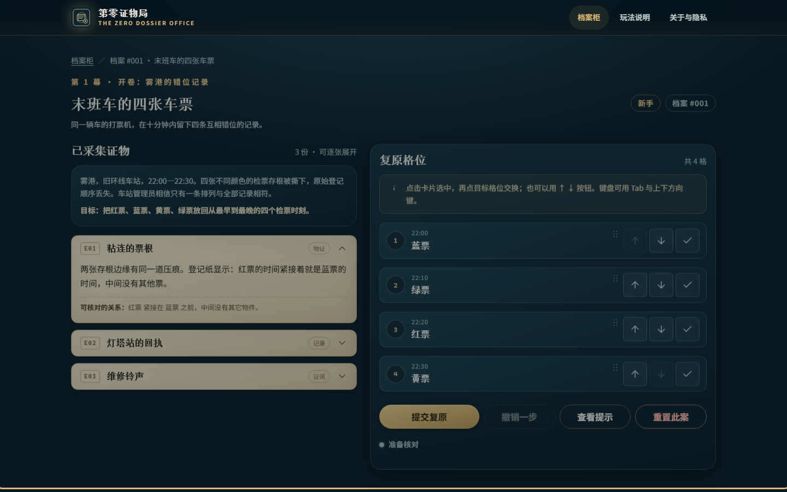
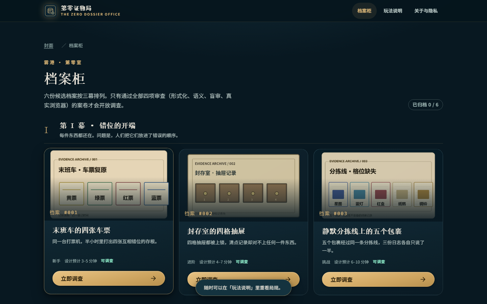
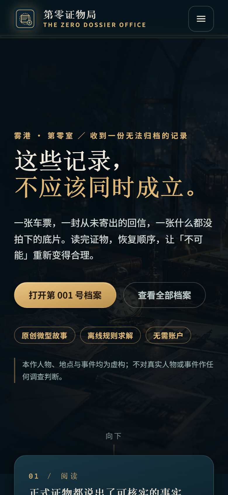
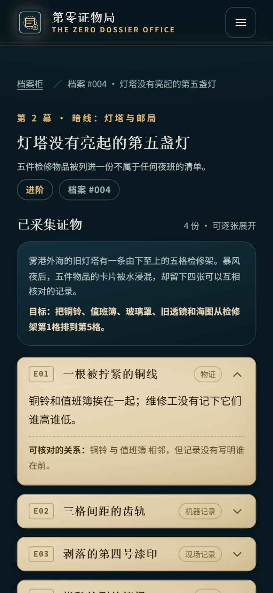

<div align="center">


# 第零证物局 · The Zero Dossier Office

**在雾港的异常档案局里，你不是找凶手，而是把互相错位的真实记录重新归位。**

[](https://github.com/tbj0623/zero-dossier-office/actions/workflows/ci.yml)
[](LICENSE)
[](ASSETS_LICENSE.md)

**[▶ 在线游玩](https://tbj0623.github.io/zero-dossier-office/)** · **[itch.io 版](https://tbj0623.itch.io/zero-dossier-office)** · [玩法说明](docs/GAMEPLAY.md) · [作者指南](docs/AUTHOR_GUIDE.md) · [隐私](docs/PRIVACY.md)

</div>

## 双平台入口（均已上线）

两个地址都能直接玩，内容同源但分发方式不同：

| 平台 | 入口 | 区别 |
|---|---|---|
| **GitHub Pages** | <https://tbj0623.github.io/zero-dossier-office/> | **完整站**：由 Actions 从本仓库 `dist/` 同源部署，中英双语随时切换，`main` 一推送即刻生效；源码、issue、CI 结果都在同一仓库 |
| **itch.io** | <https://tbj0623.itch.io/zero-dossier-office/> | **HTML5 发行包**：上传的是 `release/itch-html5-release.zip`（710 KB / 27 文件），在 itch 的 iframe 里嵌入游玩（1280 × 800，可全屏），版本不与仓库自动同步，需手动重传 |

> **当前定位：技术合格公测版。**
> 逻辑、三引擎、无障碍与隐私验证完整，但**还没有任何真实人类试玩数据**
> （G5 = `NOT_DONE`，见 [docs/PLAYTEST_PROTOCOL.md](docs/PLAYTEST_PROTOCOL.md)）。
> 因此本仓库不写"已获好评""玩家喜爱"这类没有样本支撑的话——没测过就不说。

## 真实运行截图

以下全部为**已部署站点**（GitHub Pages）在真实 Chromium 中的实拍，非概念稿、非 mockup。

| 调查桌（桌面） | 结案复盘（桌面） |
|---|---|
|  |  |

| 档案柜 | 首页（手机 390px） |
|---|---|
|  |  |

<details>
<summary>更多截图：首页（桌面）、调查桌（手机 390px）</summary>




</details>

> ⚠️ 本仓库同时保存「可玩站点」与「制作档案」。`cases/author/` 含作者解答，**仅供内部校验**，不进入站点构建产物。

---

## 这是什么

一个原创、免费、**免注册**、低资源占用的浏览器微型推理游戏。六份档案分三幕：读证物 → 复原顺序 → 提交归档。

每案解决的不是「魔法」，而是**对事实的误读**：一次分类错误、一份错版图纸、一个被当成事件的校准动作。

- **不需要在线大模型**：所有判定都是浏览器内的确定性穷举求解。
- **不上传你的答案**：没有后端、没有账号、没有跟踪脚本。
- **手机与键盘均可完整游玩**：拖放只是增强，按钮才是主路径。

## 玩法

1. **读证物** —— 每张证物都写明了一种可核实的关系：先后、相邻、间距、夹在中间、固定格位。
2. **排格位** —— 点击卡片选中，再点目标格位交换；或使用 ↑↓ 按钮。
3. **提交复原** —— 系统逐条核对，只告诉你「哪些关系不符」，绝不替你排好。

三档提示逐级给出：方法 → 关键组合 → 较直接的推导。**提示不会自动完成排列，也不扣分。**

结案页分成两段：**逻辑复盘**（可由证据严格证明的排序）与**档案后记**（作者叙事，结案后补充）。二者在数据层就是分开的，不拿故事冒充推理结论。

## 六案与三幕

| 幕 | 档案 | 机制焦点 |
|---|---|---|
| I · 错位的开端 | NA-001 末班车的四张车票 | `immediately_before` + `not_at` |
| | NA-002 封存室的四格抽屉 | 绝对格位 + 定向相邻 |
| | NA-003 静默分拣线上的五个包裹 | 双链拼接 |
| II · 灯塔与回信 | NA-004 灯塔没有亮起的第五盏灯 | `adjacent`（无方向）+ `distance` + `between` |
| | NA-005 寄不到的第五封回信 | `between` 的逆向推理 + `distance` |
| III · 第零张底片 | NA-006 第零号空白底片 | 六件综合 + 终章 |

## 技术

| 层 | 说明 |
|---|---|
| 运行时 | 纯静态 HTML/CSS/ES Modules，**零依赖、零构建必需** |
| 判定 | `engine/solver.mjs` —— 单一求解核心，站点与测试共用同一份逻辑 |
| 校验 | `engine/verify_cases.py` —— 独立 Python 实现，用于交叉验证 |
| 规模 | 3–8 件物品穷举；最难的 NA-006 为 6! = 720 种排列 |
| 部署 | GitHub Pages（Actions 构建）或任意静态托管 |

### 本地运行

```bash
# 任意静态服务器即可，注意必须用 HTTP（ES Modules 不接受 file://）
python -m http.server 8080 --directory dist
# 打开 http://127.0.0.1:8080
```

### 构建与测试

```bash
node tools/build.mjs                       # 生成 dist/
python engine/verify_cases.py              # 作者版唯一解 + 逐条必要性
python -m unittest discover -s tests/logic -p 'test_*.py'
node --test tests/logic/solver.test.mjs
python tests/logic/cross_check.py          # Python ⇄ JS 真值表比对
python tests/browser/e2e.py --base http://127.0.0.1:8080   # 需要 Playwright
```

## 语言

游戏内置**中文（默认）与英文**两种界面，可在导航栏用 `EN` / `中文` 按钮切换，或用
`?lang=en` 直接进入英文版。选择记在本地（`zd:v1:lang`），不上传。

英文翻译**不改变谜题逻辑**：求解器内部始终使用中文规范 ID，语言只影响显示字符串。
这一点由测试保证——英文模式下六个案件全部能用英文物件名通关（12/12 断言）。

## 三个引擎实测

| 引擎 | 旅程检查 | 六案通关 | 布局差异 |
|---|---|---|---|
| Chromium 151 | 38/38 | 6/6 | 基准 |
| Firefox 153 | 43/43 | 6/6 | ≤1.85 px（header/hero 0.00 px） |
| WebKit 26.5 | 34/34 | 6/6 | ≤1.14 px |

三引擎统一回归 `tests/browser/cross_engine.py`：**42/42 PASS**。

各引擎发现的真实问题都已修复，其中一条值得单独说：**Safari 默认不把普通 `<a href>`
放进 Tab 序列**，实测键盘用户在这站点的首页 20 个链接里**一个都到不了**。
已给所有链接补 `tabindex="0"`，修复后 WebKit 的 Tab 序列与 Chromium 逐项相同。

> Playwright 的 WebKit 共享 Safari 的引擎但不共享图形栈，所以正确说法是
> 「WebKit 已验证；真实 Safari 未验证」。真实 iOS Safari 与屏幕阅读器均未测。

## 独立审计

本项目邀请了四个**互相独立、互不共享上下文**的审查角色，各自只读、只能写自己的目录：

| 审计 | 发现 | 结果 |
|---|---|---|
| 独立盲审 | 只读剥离答案的材料自行推导 | 3 轮后 6/6 CLEAN；抓出 NA-006「相差三次」的**双读**（两种读法各得唯一但不同的解） |
| 红队 | 隐私/版权/伦理/误导/安全 | 1 critical + 3 high，**全部修复** |
| 无障碍 | axe-core + 11 项人工检查 | 3 critical（skip-link 踢出页面、焦点丢失、结案页失焦），**全部修复** |
| 跨引擎/性能 | Chromium vs Edge | **0 差异**；TTI 1327ms；首屏 45 KB；无 XSS |

此外还有叙事主线审稿（`work/lore/MAINLINE_REVIEW.md`），抓出「主线彩蛋从未渲染到玩家面前」
「封面图印着答案」「终章与改写后的第 006 案矛盾」等 must-fix，均已修复。

### 每一道门禁都被证明"会失败"

红队指出的最深刻问题不是某个 bug，而是**门禁本身可能是假的**：
CI 里那条「无第三方资源」检查用了 GNU grep 不支持的 Perl 负向前瞻，
永远匹配不到任何东西，却一直是绿的。

因此现在每道新增门禁都做过**反向验证**——植入一个已知坏输入，确认它真的会 exit 1：

| 门禁 | 反向验证 |
|---|---|
| `check_no_remote.py` | 植入 `cdn.evil.example` 脚本 → 正确 exit 1 |
| `check_links.py` | 植入指向不存在文件的链接 → 正确 exit 1 |
| `check_cover_art.py` | 把封面物件顺序改成答案顺序 → 正确 exit 1 |
| `check_license_coverage.py` | 曾真实拦下被误提交的 `site/cases/*` |
| E2E「单击恰好移动一格」 | 双击绑定 bug 曾让 36 项测试全绿却漏掉，新增此断言 |

## 质量门禁

每个案件必须同时通过**四项独立签核**才会出现在正式档案柜：

1. **形式化**：唯一解 + 每条约束去掉后出现多解（无冗余线索）+ Python/JS 一致。
2. **语义**：每条 `evidence.body` 的中文读法与 `op` 参数严格同义，见 `work/lore/SEMANTIC_REVIEW.md`。
3. **盲审**：只给剥离答案的材料，由独立解题者自行推导，见 `work/blind/BLIND_REPORT.md`。
4. **浏览器**：真实浏览器完成通关，见 `screenshots/browser-report.json`。

签核结果逐案落在 `review/<id>-{formal,semantic,blind,browser}.json`。**任何一项缺失，该案状态为 `BLOCKED`，不进档案柜。**

## 隐私

- 无账户、无后端、无分析脚本、无第三方 CDN、无远程字体。
- 进度只写在 `localStorage`（键前缀 `zd:v1:`），可随时在「玩法说明」页一键清除。
- 求解完全在本地完成，**你的答案不会被发送给任何在线 AI 或服务器**。

详见 [docs/PRIVACY.md](docs/PRIVACY.md)。

## 许可

- **程序代码**：[MIT](LICENSE)
- **叙事、案件文本、视觉资产**：[CC BY-NC-SA 4.0](ASSETS_LICENSE.md)

字体不分发（使用访问者本机系统字体）。图片是氛围层，解题所需信息永远以 HTML 文本呈现。

## 虚构声明

全部人物、地点、机构与事件均为虚构的架空世界「雾港」。本作不影射真实死者、真实机构或现存个人，也不以伪造的历史文书冒充真实档案。

## 已知限制

- 静态 JavaScript 天然可被查看，**本作不提供、也不声称提供「无法看答案」的防作弊**。公平性靠设计，不靠代码隐藏。
- 形式化唯一解 **不等于** 好玩，也不等于文字无歧义——所以才有语义审稿与独立盲审。
- 本仓库的玩家反馈章节只记录**真实发生**的试玩；没有结果时明确写「未验证」。
